  

   

  

   

  
  
  

---

### About Me

- 🎓 Computer Science student at **Universitas Pendidikan Indonesia (UPI)**.
- 🔐 Currently exploring **Cyber Security** and **Web Development**.

---

### Tech Stack

  

---

### GitHub Stats & Activity

  
  

    

  

    

  

    

  <picture>
    <source media="(prefers-color-scheme: dark)" srcset="https://raw.githubusercontent.com/nluthfi/nluthfi/pacman-output/pacman-contribution-graph-dark.svg?game=pacman" />
    <source media="(prefers-color-scheme: light)" srcset="https://raw.githubusercontent.com/nluthfi/nluthfi/pacman-output/pacman-contribution-graph.svg?game=pacman" />
    
  </picture>

